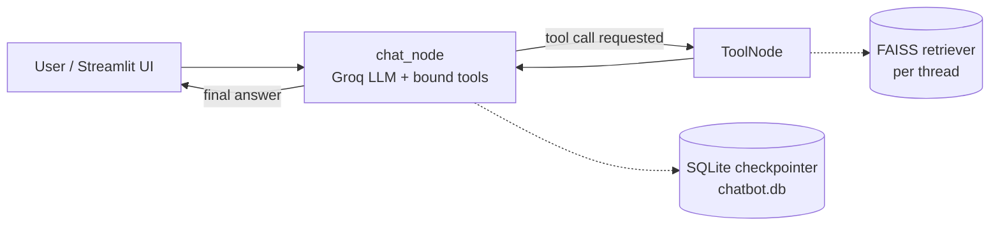

# 🤖 Multi-Utility Chatbot — LangGraph + RAG + Tools

A conversational AI assistant built with **LangGraph** and **Streamlit** that can chat over your own **PDF documents** (RAG), search the web, fetch live stock prices, and do arithmetic, all with **persistent, multi-thread conversation memory**.


---

## ✨ Features

- 📄 **Chat with your PDFs**: upload a PDF per conversation; it is chunked, embedded, and indexed in FAISS for retrieval-augmented answers.
- 🧠 **Agentic tool use**: the LLM decides when to call a tool (web search, stock price, calculator, PDF retrieval) using LangGraph's conditional routing.
- 💾 **Persistent memory**: conversations are checkpointed to SQLite, so past chats can be reopened from the sidebar.
- 🧵 **Multi-thread chats**: each conversation has its own thread ID, and each thread gets its own PDF index.
- ⚡ **Streaming responses**: tokens stream live into the UI, with a status indicator showing which tool is running.
- 🔒 **Local embeddings**: document embeddings are generated locally with a Sentence-Transformers model, so PDF content is not sent to an embedding API.

---

## 🧰 Tools Available to the Agent

| Tool | What it does |
|------|--------------|
| `rag_tool` | Retrieves the top-4 relevant chunks from the PDF uploaded in the current thread |
| `DuckDuckGoSearchRun` | Searches the web for current information |
| `get_stock_price` | Fetches the latest quote for a ticker via the Alpha Vantage API |
| `calculator` | Performs add / sub / mul / div with input validation (e.g. division-by-zero handling) |

---

## 🏗️ Architecture



**How a turn works**

1. The user sends a message (optionally after uploading a PDF).
2. `chat_node` calls the LLM with the tool schemas bound to it, plus a system prompt that includes the current `thread_id`.
3. If the model requests a tool, `tools_condition` routes to `ToolNode`, which runs it and returns the result to `chat_node`.
4. Once no more tools are needed, the answer streams back to the UI.
5. Every step is checkpointed to SQLite under the thread ID.

**PDF ingestion pipeline:** `PyPDFLoader` → `RecursiveCharacterTextSplitter` (1000-char chunks, 200 overlap) → `all-MiniLM-L6-v2` embeddings → FAISS similarity retriever (`k=4`).

---

## 🛠️ Tech Stack

| Layer | Technology |
|-------|-----------|
| Orchestration | LangGraph (`StateGraph`, `ToolNode`, `SqliteSaver`) |
| LLM | Groq API via `langchain-groq` |
| Embeddings | `sentence-transformers/all-MiniLM-L6-v2` (HuggingFace, local) |
| Vector store | FAISS |
| Document loading | PyPDF, LangChain text splitters |
| Frontend | Streamlit |
| Persistence | SQLite |

---

## 📂 Project Structure

```
CHATBOT/
├── langraph_backend.py     # LangGraph agent, tools, PDF ingestion, checkpointer
├── <your_frontend>.py      # Streamlit UI (chat, sidebar, PDF upload, thread history)
├── chatbot.db              # SQLite conversation store (created on first run)
├── requirements.txt
├── .env                    # API keys (not committed)
└── README.md
```

---

## 🚀 Getting Started

### 1. Clone the repo

```bash
git clone https://github.com/AARANYA-SINGH12/CHATBOT.git
cd CHATBOT
```

### 2. Create a virtual environment

```bash
python -m venv venv
source venv/bin/activate        # macOS / Linux
venv\Scripts\activate           # Windows
```

### 3. Install dependencies

```bash
pip install -r requirements.txt
```

If you don't have a `requirements.txt` yet, these are the packages the code imports:

```bash
pip install streamlit python-dotenv requests pypdf faiss-cpu sentence-transformers \
  langchain-core langchain-community langchain-text-splitters langchain-groq \
  langchain-huggingface langgraph langgraph-checkpoint-sqlite duckduckgo-search
```

### 4. Add your API keys

Create a `.env` file in the project root:

```env
GROQ_API_KEY=your_groq_api_key
ALPHAVANTAGE_API_KEY=your_alpha_vantage_key
```

> ⚠️ Never commit `.env` or hardcode keys in source files. Add `.env` to `.gitignore`.

### 5. Run the app

```bash
streamlit run <your_frontend>.py
```

---

## 💡 Example Prompts

- *"Summarize the main findings of the uploaded paper."*: uses `rag_tool`
- *"What's the latest price of AAPL?"*: uses `get_stock_price`
- *"What is 1284 divided by 12?"*: uses `calculator`
- *"What's in the news about open-source LLMs today?"*: uses web search

---

## ⚠️ Known Limitations

- **PDF indexes are held in memory.** Conversation history persists in SQLite, but after a restart you need to re-upload a PDF to query it again.
- Retrieval uses plain similarity search over fixed-size chunks; no re-ranking yet.
- The calculator supports one operation on two numbers at a time.
- Answer quality for PDF questions depends on the underlying LLM and on how well the PDF text extracts (scanned PDFs without a text layer won't work).

---

## 🔮 Roadmap

- [ ] Persist FAISS indexes to disk so documents survive restarts
- [ ] Support multiple PDFs and other formats (DOCX, TXT) per thread
- [ ] Show source page references alongside answers
- [ ] Add retrieval re-ranking and evaluation on a small Q&A set
- [ ] Dockerize and deploy on Streamlit Community Cloud

---

## 🙌 Acknowledgements

Built with [LangGraph](https://github.com/langchain-ai/langgraph), [LangChain](https://github.com/langchain-ai/langchain), [Streamlit](https://streamlit.io/), [FAISS](https://github.com/facebookresearch/faiss), and [Groq](https://groq.com/).

---

## 👤 Author

**Aaranya Singh**: [GitHub](https://github.com/AARANYA-SINGH12)
